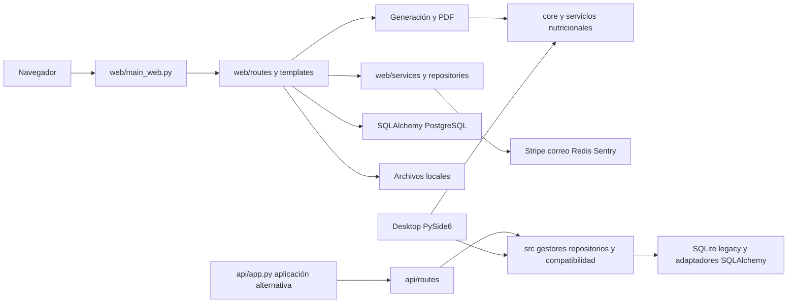
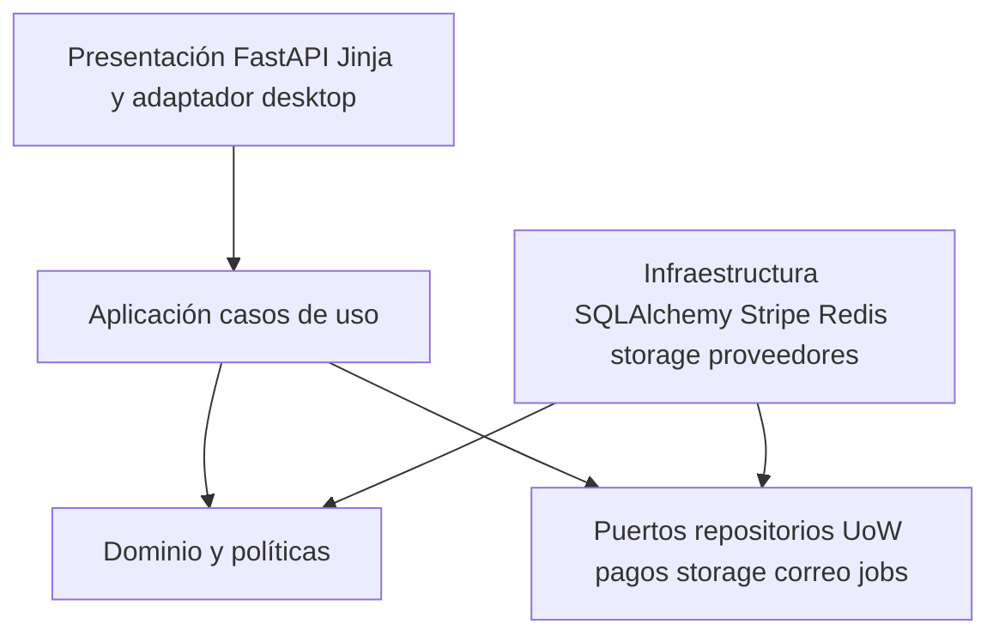
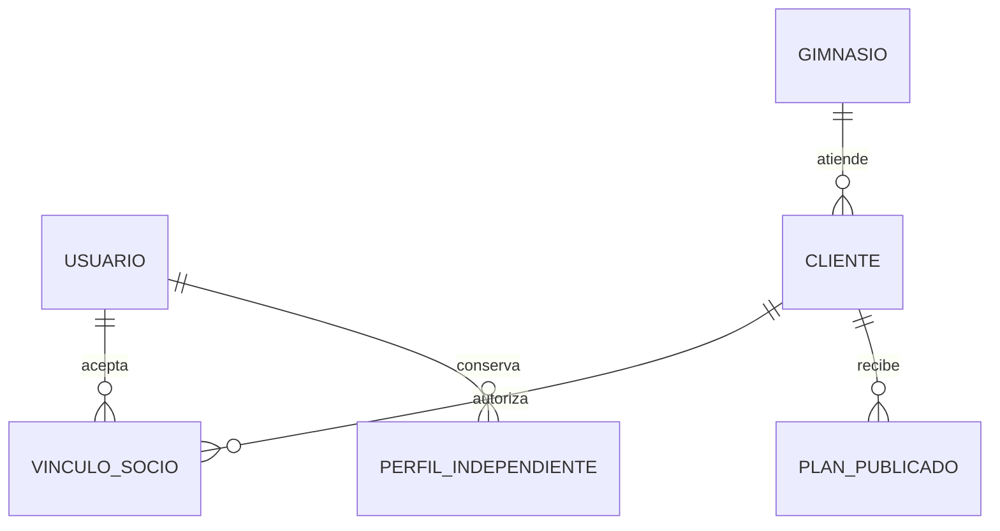

# Arquitectura y documentación de MetodoBase

La propuesta es evolucionar el monolito existente por casos de uso. FastAPI, Jinja, SQLAlchemy y el motor nutricional ya ofrecen una base suficiente para mejorar el producto. La prioridad es hacer consistentes los límites de negocio, transacciones y permisos; una reescritura de frontend o la separación en microservicios no resuelve los fallos encontrados.

## Arquitectura observada



El diagrama muestra dependencias principales inspeccionadas, no un inventario exhaustivo de cada llamada. Conviven dos composiciones FastAPI, gestores legacy y repositorios nuevos, varios generadores/exportadores PDF y fuentes de configuración. Su coexistencia requiere contratos y un plan de retiro explícitos. Las fases de migración de `config/feature_flags.py` no deben utilizarse como prueba de que el dato real ya está consolidado.

## Límites que necesitan fortalecerse

| Límite | Evidencia o síntoma | Cambio incremental |
|---|---|---|
| Presentación y negocio | Rutas de usuario actualizan plan/precio y estado de suscripción | Extraer casos de uso de suscripción y generación con políticas únicas |
| Identidad y pertenencia | Login/refresh pierden datos de rol/equipo; navegación usa tipo de cuenta | Principal autenticado consistente y membresía explícita de gimnasio |
| Persistencia y tenant | Sesiones creadas directamente no siempre instalan contexto; RLS ausente en producción | Fábrica transaccional única y política de acceso en caso de uso y repositorio |
| Planes y cuotas | Generación del cliente no aplica el contador mensual | Reserva atómica de cuota y publicación de resultado tras persistencia válida |
| Dominio y archivos | Generación y branding dependen de rutas locales | Puerto de documentos/objetos con adaptador de almacenamiento |
| Web y desktop | `api/`, `web/`, `src/compat` y gestores tienen flujos paralelos | Identificar consumidores; contratos compartidos y retiro medido de cada camino legacy |
| Configuración | `.env.example`, settings, validadores y documentación pueden divergir | Esquema tipado, ejemplos generados y validación por entorno |
| Operación y producto | Documentos afirman controles terminados que no están aplicados en Railway | Estado verificable por commit, entorno y evidencia |

## Arquitectura objetivo



El dominio no importa FastAPI, SQLAlchemy, Stripe ni variables de entorno. Los casos de uso reciben dependencias e identidad autorizada. Infraestructura implementa los puertos; la composición de la aplicación conecta los adaptadores. Los routers validan entrada, invocan un caso de uso y traducen resultados o errores; no conceden Pro ni fijan precios de forma independiente.

Una estructura orientativa, a introducir por módulo durante cambios necesarios:

```text
metodobase/
  identity/      dominio y aplicación de identidad y membresías
  tenants/       gimnasio equipo permisos y configuración
  nutrition/    cálculo restricciones generación y versiones de planes
  billing/      catálogo entitlements suscripciones pagos y conciliación
  engagement/   progreso hábitos y seguimiento
  infrastructure/ database storage email payments jobs observability
  presentation/ web api desktop
```

No se propone mover todos los archivos de una vez. Comenzar con `billing` y la autorización, mantener adaptadores para firmas existentes y sustituir consumidores uno a uno con pruebas de contrato. Conservar el motor nutricional que pase las pruebas; extraer únicamente las dependencias que impidan probarlo y reutilizarlo.

## Reglas de diseño y datos

1. **Principal explícito.** Separar `account_type`, `user_id`, `gym_id`, `membership_id`, `role` y permisos efectivos. Verificar estado activo y cambios de membresía en operaciones sensibles. El cliente no elige el gimnasio autorizado mediante un campo de petición.
2. **Una política por capacidad.** Plan de licencia SaaS, membresía del cliente del gimnasio y suscripción individual son conceptos distintos; definirlos y nombrarlos en API/UI. Aplicar la misma política de cuota y características a todas sus rutas.
3. **Una unidad de trabajo por caso de uso.** Un `commit` interno no debe desactivar el contexto de tenant de operaciones posteriores. Tras cada transacción, establecer de nuevo contexto cuando corresponda. Los errores se traducen sin devolver información sensible.
4. **Dinero y tiempo consistentes.** Importes en unidades menores o `Decimal` con moneda; fechas conscientes de zona; caducidad y cuotas por periodo de facturación definido. Mostrar MXN, impuestos y periodicidad de forma explícita.
5. **Estados persistidos.** Suscripción pendiente, activa, vencida/cancelada y pago deben tener transiciones autorizadas. Un redirect del navegador no es prueba del estado de pago. El servidor calcula el acceso desde datos verificados.
6. **Idempotencia y concurrencia.** Reutilizar y endurecer la idempotencia existente; claves únicas para eventos externos y acciones repetibles. Actualizar cuota y persistir plan de forma atómica, con política explícita de compensación si falla PDF/almacenamiento.
7. **Trabajo durable cuando sea necesario.** La generación y los efectos externos no deben perderse si muere un worker. Introducir job persistido y outbox para entrega/reintentos según carga y necesidad, antes de escalar réplicas.
8. **Identidad del plan.** Registrar versión del motor, entrada validada, restricciones, resultado nutricional y estado de documento. No registrar tokens ni notas de salud en logs de depuración.
9. **Datos de salud explícitos.** Separar alergias y exclusiones estructuradas de notas libres. La UI sólo puede prometer el filtrado que el motor aplica y prueba.
10. **Contratos compartidos.** Versionar los endpoints externos cuando cambien; comprobar OpenAPI contra frontend y mantener un periodo de compatibilidad documentado para desktop.

## Vinculación del socio con el gimnasio

El perfil individual actual crea su propio `Cliente` en `web/routes/usuario.py:55`. No se debe transformar ese registro en cliente de un gimnasio cambiándole `gym_id`, ni inferir pertenencia por coincidencia de correo. Mantener el uso independiente y añadir un vínculo explícito entre cuenta autenticada y cliente del gimnasio, distinto de `team_gym_id`, que pertenece al equipo profesional.

Una entidad propuesta `ClientAccountLink` contendría `gym_id`, `cliente_id`, `user_id`, estado, aceptación y permisos de compartición. La invitación necesita token almacenado como hash, caducidad y canje de un uso; el servidor verifica destinatario y consistencia entre cliente y gimnasio. Esta entidad todavía no existe: es un diseño a refinar con el alcance de membresías del producto.



El diagrama expresa el modelo conceptual objetivo y no reproduce tablas actuales. La primera entrega sería lectura del plan vigente que el profesional publicó: resolver un vínculo activo desde `user_id` del token, establecer contexto transaccional y cargar únicamente ese cliente y su plan autorizado. El gimnasio elegido en la UI nunca basta como autorización. Mostrar contextos claros «Mi plan personal» y «Mi gimnasio» para evitar mezclar carteras.

El diario individual puede persistirse antes de construir ese vínculo. Comidas/agua necesitan propietario, contexto y fecha local; `ClientProgress` existente puede reutilizarse para mediciones corporales, sin forzar registros diarios de otra naturaleza en la misma tabla. Compartir seguimiento con el profesional requiere un permiso explícito. Revocar el vínculo bloquea lectura de datos del gimnasio y conserva el perfil independiente conforme a la política de conservación.

Las pruebas del nuevo recorrido deben cubrir dos gimnasios, destinatario incorrecto, invitación expirada o reutilizada, revocación y una cuenta independiente sin vínculo. La creación del vínculo nunca debe conceder permisos de equipo.

## Documentación de código que falta

La documentación existente es abundante, pero parte refleja marzo de 2026. Por ejemplo, `ROADMAP.md` presenta PostgreSQL y Alembic como trabajo futuro, mientras el servicio ya usa PostgreSQL; `docs/PRODUCTION_READINESS_CHECKLIST.md` declara pruebas y fases antiguas. No se sustituyen ni borran durante la auditoría: hay que conservarlos como históricos y establecer una fuente vigente.

| Documento mantenido | Contenido mínimo | Responsable propuesto |
|---|---|---|
| README de desarrollo | Qué hace el producto, dos tipos de usuario, arranque web, requisitos, pruebas, enlace a arquitectura | Tech lead |
| Mapa C4 | Contexto, contenedores, módulos, almacenamiento y proveedores; distinguir actual de objetivo | Backend |
| ADR | Decisión, contexto, alternativas, consecuencias y criterio de revisión | Autor del cambio |
| Catálogo de dominio | Tenant, cliente, usuario, membresía, plan nutricional, licencia, suscripción y pago | Producto + backend |
| Matriz de autorización | Roles por recurso y acción, fuente de pertenencia, excepciones de soporte | Seguridad + backend |
| Contratos API | Esquemas, errores, paginación, idempotencia, límites, ejemplos sin datos personales | Backend + frontend |
| Contratos del motor | Unidades, invariantes nutricionales, exclusiones, límites y reproducibilidad | Responsable del motor |
| Modelo de datos | ERD, claves, índices, unicidad, soft delete, retención, tenant y RLS | Backend |
| Runbooks | Deploy/migración/rollback, restauración, Redis, webhooks, correo y compromiso de credenciales | Operación |
| Diseño web | Tokens CSS, componentes, estados, responsive, teclado y accesibilidad | Diseño + frontend |
| Estrategia de pruebas | Capas, entornos, datos sintéticos, matriz de roles y escenarios de fallos | QA |

Los docstrings deben describir precondiciones e invariantes, unidades, transacciones, excepciones y efectos externos cuando existan. Evitar repetir el nombre de la función como explicación. Los comentarios deben explicar decisiones y restricciones. Añadir ejemplos pequeños para contratos difíciles, no comentarios línea por línea.

Plantilla de ADR recomendada:

```text
Título y fecha
Estado y responsables
Problema y restricciones verificadas
Decisión
Alternativas consideradas
Consecuencias y riesgos
Migración y reversión
Pruebas y evidencia
Fecha o condición de revisión
```

## Secuencia de adopción

Primero documentar y corregir transiciones de pago, identidad y tenant; después migraciones, roles de base y storage. Luego extraer generación/cuotas y su transacción. Al cerrar cada recorrido, retirar duplicaciones que hayan perdido consumidores y mantener adaptadores de desktop sólo donde tengan uso confirmado. Introducir comprobaciones de dependencias entre capas cuando los límites nuevos existan; una regla que sólo vigile nombres de carpetas no demuestra arquitectura limpia.

Se considera completado un caso de uso cuando API y UI usan el mismo contrato, el permiso es verificable, las transacciones y errores son explícitos, existe una prueba del comportamiento relevante y la documentación describe el comportamiento desplegable.
