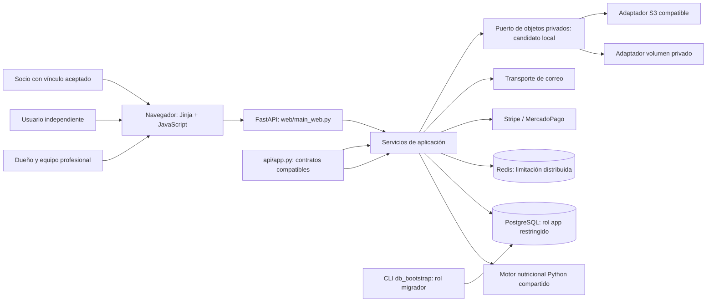
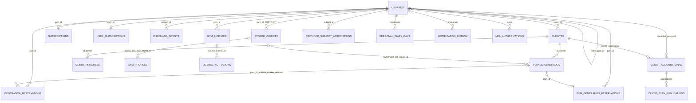

# Arquitectura del candidato web local

Código de aplicación integrado en `59b64e02`, sin cambios de producto posteriores hasta `29c58383`; esquema37 `20261020_account_security`. Estado por commit en [CAMBIOS.md](CAMBIOS.md) y aceptación por entorno en [VALIDACION.md](VALIDACION.md). Este mapa describe el candidato local; las pruebas no acreditan una actualización de producción. Por decisión posterior del usuario, el trabajo vigente se limita al servicio web: desarrollo, pruebas y empaquetado desktop quedan fuera de este lote.

## Contexto y contenedores

`web/main_web.py` es la composición SaaS publicada y la referencia de los recorridos. `api/app.py` conserva contratos de compatibilidad y se prueba por separado; no se afirma paridad de todas las pantallas/rutas personales. Ambos usan identidad persistida, esquema verificado y los servicios compartidos que ya están conectados. SQLite sirve para desarrollo/pruebas; no representa la autoridad multiusuario productiva.

El navegador usa access token en RAM y refresh mediante cookie HttpOnly del mismo origen. `web/browser_session.py` y `api.js` incorporan CSRF, rotación y coordinación entre instancias/pestañas; el almacenamiento conserva una época de coordinación y retira las credenciales legacy durante su migración. R12, el diario persistido, MFA y seguridad de cuenta37 están integrados. Los ensayos de correo usan destinatarios y transportes de prueba; no demuestran entrega real.

## Módulos y fronteras

| Responsabilidad | Implementación actual | Frontera relevante |
| --- | --- | --- |
| Catálogo y estados comerciales | `core/plan_catalog.py`, `core/subscription_policy.py` | Free10 clientes/1 plan por cliente al día/10 totales diarios por gimnasio/20 al mes; consumidores no conceden Pro por una redirección |
| Nutrición y restricciones | `core/`, `src/`, `core/food_catalog.py` | Snapshot inmutable por solicitud; resultado verificado antes del PDF |
| Identidad/RBAC | `web/auth.py`, `auth_deps.py`, `services/permissions.py` | Rol/team/versión se recargan del principal persistido; permiso desconocido denegado |
| Aislamiento | `database/tenant_context.py`, `tenant_policy.py`, middleware tenant | Contexto transaccional, SET LOCAL y tareas con tenant explícito;32 tablas FORCE RLS en esquema37 |
| Dinero | `services/billing_integrity.py`, `subscription_service.py`, routers billing/webhooks | Intención previa al proveedor; estado firmado/verificado e idempotencia |
| Cuota individual | `services/generation_quota.py` | Esquema26: protocolo1, periodo capturado y marcador de publicación en la transacción Plan/ready; lector exige Plan/Cliente del mismo dueño |
| Cuota profesional | `services/gym_generation_quota.py`, `quota_calendar.py` | Lock de cuenta antes de decisión; ledger24 y publicación CAS, sin reembolso de resultados publicados |
| Worker compartido | `services/plan_generation.py` | Web/API conservan wrappers; motor/PDF/JSON/persistencia tienen un recorrido común; intenciones individual/profesional explícitas y excluyentes |
| Exportación personal | `services/privacy_export.py`, router y UI de descarga | Identidad personal; GET readonly y presupuesto de bytes; cartera profesional excluida; borrado/retención abiertos |
| Transporte de sesión | `web/browser_session.py`, `web/static/js/api.js`, `session-shell.js` | Access en RAM, refresh HttpOnly, fences de identidad, CSRF y coordinación del navegador; un401 de recurso retira el estado de la instancia capturada antes de leer el cuerpo |
| MFA y cuenta | `web/routes/mfa.py`, `services/mfa_service.py`, `routes/account_security.py` | MFA, recuperación, verificación de correo y cambio de contraseña; sin afirmación de entrega real de correo |
| Diario y vínculo de socio | `routes/personal_diary.py`, `services/personal_diary_persistence.py`, `routes/client_links.py` | Persistencia propia, invitación/aceptación y publicación autorizadas; no se infiere relación por correo compartido |
| Seguimiento | `routes/followup.py`, `services/followup_service.py`, `services/progress_*` | Historial y proyecciones coherentes; exportación, compartición y retiro sujetos a identidad, propiedad y consentimiento |
| Notificaciones | `routes/notifications.py`, `services/notifications.py`, `services/notification_worker.py` | Preferencias, hechos, outbox e intentos persistidos; los transportes de prueba no equivalen a envíos reales |
| Analítica R30 | `web/product_analytics_domain.py`, `services/product_analytics.py`, `routes/product_analytics.py` | Hechos privados observados, lectura consistente y volumen acotado; no representa cohortes globales ni una baseline comercial aprobada |
| Rutinas PPL | `core/routine_catalog.py`, `services/routine_catalog.py`, `routes/routines.py`, `web/static/js/rutinas.js` | Catálogo general de13 ejercicios sin datos de salud ni consumo de cuota; selector semanal, temporizador e impresión |
| Presentación | `web/static/css/design-system.css`, `web/templates/base.html`, `base_usuario.html` | Diseño atlético de ambos portales, navegación, formularios y estados; conserva los colores originales de la landing |
| Persistencia | SQLAlchemy `database/models.py`, `repository.py` | Consultas con propietario explícito además de RLS; migración fuera del tráfico |
| Objetos | `web/storage`, `services/private_objects.py`, `plan_documents.py`, `gym_logos.py` | Intención antes de PUT; ready/referencia transaccionales, kind/owner/backend/SHA; destino real y migración histórica pendientes |
| Operación | CLI Alembic, backup/restore, Redis y handlers de errores | Fallos bloqueantes; logs automáticos saneados en el seguimiento actual |

Esta separación es incremental. Los servicios de aplicación todavía contienen DTO/errores FastAPI y SQLAlchemy; no se declara una arquitectura de dominio completamente desacoplada. Se conserva el núcleo histórico compartido. No se cambió de framework ni se añadieron microservicios.

## Identidad y relaciones persistidas

El ERD selecciona relaciones de autoridad y no reproduce todas las tablas, columnas o claves. La relación de socio exige el vínculo persistido y su consentimiento. Equipo profesional, cliente de gimnasio, socio, licencia SaaS y suscripción individual son conceptos diferentes. El esquema37 tiene41 tablas ORM,42 tablas físicas incluida Alembic y32 tablas FORCE RLS. SQLite permite probar servicios y HTTP, pero no demuestra equivalencia de RLS, transacciones readonly o carreras PostgreSQL. Ninguna migración histórica se reescribe.

## Decisiones y contratos enlazados

- [Decisiones de ejecución](DECISIONES.md): autorización y límites comerciales, calendario, fechas históricas y conservación.
- [Identidad/tenant y migrador](AISLAMIENTO.md), [equipo e invitaciones](EQUIPO.md), [licencias](LICENCIAS.md).
- [Dinero e idempotencia](evidence/backend-money-contract.md), [catálogo](CATALOGO.md), [reservas B2B](B2B_CUOTAS.md).
- [Publicación individual](CUOTA_INDIVIDUAL.md), [sesiones HTTP por instancia](SESIONES_HTTP.md), [cleanup](CLEANUP.md).
- [Objetos](ALMACENAMIENTO.md), [backup/restore](BACKUP_RESTORE.md), [Redis](REDIS.md), [UTC](UTC_DATETIME.md).
- [Inventario de privacidad](PRIVACIDAD.md), [contención de logs automáticos](evidence/security-error-privacy.md).
- [Rediseño](REDISENO_WEB_IMPLEMENTACION.md), [rutinas](RUTINAS_WEB_CONTRATO.md) y [analítica R30](ANALITICA_PRODUCTO_R30_V1.md).

El diseño y PPL tienen recorridos nativos locales de cuenta/notificaciones y rutinas, con móvil e impresión en los alcances declarados. Las capturas y axe no equivalen a una auditoría WCAG completa o a pruebas con lector de pantalla real. La analítica tiene controles independientes de dominio/HTTP y PostgreSQL; su baseline sigue siendo provisional.

Siguen pendientes la regresión amplia serial/paralela del candidato final, la imagen Linux57 realmente construida, su inventario instalado/SBOM/SCA y los controles actuales Redis/carga. El contexto de imagen preparado contiene483 archivos Git y470 archivos de aplicación; no es una imagen ejecutada. Retención y borrado legal, eliminación integral de cuenta/copias, proveedor durable y migración histórica de objetos, proveedores reales, custodia/recuperación y evaluación con participantes conservan sus decisiones o evidencias externas pendientes. Este mapa no declara una arquitectura desplegada.
