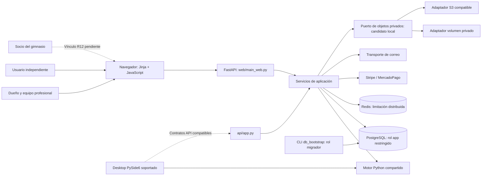
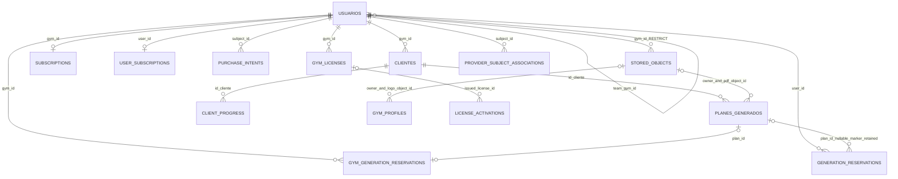

# Arquitectura del candidato local

Estado por commit en [CAMBIOS.md](CAMBIOS.md); aceptación por entorno en [VALIDACION.md](VALIDACION.md). Este mapa describe el monolito local y distingue piezas integradas de las que siguen en revisión. Producción conserva la versión histórica indicada en ESTADO.md.

## Contexto y contenedores

`web/main_web.py` es la composición SaaS publicada y la referencia de los recorridos. `api/app.py` conserva contratos de compatibilidad y se prueba por separado; no se afirma paridad de todas las pantallas/rutas personales. Ambos usan identidad persistida, esquema verificado y los servicios compartidos que ya están conectados. SQLite sirve para desarrollo/pruebas; no representa la autoridad multiusuario productiva.

El navegador sigue usando bearer persistido en almacenamiento local: R10/R31 conservan abierta su migración de exposición. No existe todavía vínculo de socio R12, diario servidor R14 ni MFA R32 completo. El correo de invitaciones tiene URL/token y estado de transporte revisados; eso no demuestra entrega a un destinatario real.

## Módulos y fronteras

| Responsabilidad | Implementación actual | Frontera relevante |
| --- | --- | --- |
| Catálogo y estados comerciales | `core/plan_catalog.py`, `core/subscription_policy.py` | Reglas sin FastAPI/SQLAlchemy; consumidores no conceden Pro |
| Nutrición y restricciones | `core/`, `src/`, `core/food_catalog.py` | Snapshot inmutable por solicitud; resultado verificado antes del PDF |
| Identidad/RBAC | `web/auth.py`, `auth_deps.py`, `services/permissions.py` | Rol/team/versión se recargan del principal persistido; permiso desconocido denegado |
| Aislamiento | `database/tenant_context.py`, `tenant_policy.py`, middleware tenant | Contexto transaccional, SET LOCAL y tareas con tenant explícito;17 familias R04 más ledger/objetos hasta19 |
| Dinero | `services/billing_integrity.py`, `subscription_service.py`, routers billing/webhooks | Intención previa al proveedor; estado firmado/verificado e idempotencia |
| Cuota individual | `services/generation_quota.py` | Esquema26: protocolo1, periodo capturado y marcador de publicación en la transacción Plan/ready; lector exige Plan/Cliente del mismo dueño |
| Cuota profesional | `services/gym_generation_quota.py`, `quota_calendar.py` | Lock de cuenta antes de decisión; ledger24 y publicación CAS, sin reembolso de resultados publicados |
| Worker compartido | `services/plan_generation.py` | Web/API conservan wrappers; motor/PDF/JSON/persistencia tienen un recorrido común; intenciones individual/profesional explícitas y excluyentes |
| Exportación personal | `services/privacy_export.py`, router y UI de descarga | Identidad personal; GET readonly y presupuesto de bytes; cartera profesional excluida; borrado/retención abiertos |
| Transporte de sesión | `web/static/js/api.js` | Revisión lógica y promesa compartida por instancia; error Storage bloquea I/O hasta save/clear completo; reload/cross-tab/escritores externos pendientes |
| Persistencia | SQLAlchemy `database/models.py`, `repository.py` | Consultas con propietario explícito además de RLS; migración fuera del tráfico |
| Objetos | `web/storage`, `services/private_objects.py`, `plan_documents.py`, `gym_logos.py` | Intención antes de PUT; ready/referencia transaccionales, kind/owner/backend/SHA; destino real y migración histórica pendientes |
| Operación | CLI Alembic, backup/restore, Redis y handlers de errores | Fallos bloqueantes; logs automáticos saneados en el seguimiento actual |

Esta separación es incremental. Los servicios de aplicación todavía contienen DTO/errores FastAPI y SQLAlchemy; no se declara una arquitectura de dominio completamente desacoplada. Los constructores nutricionales permanecen compartidos con desktop. No se cambió de framework ni se añadieron microservicios.

## Identidad y relaciones persistidas

El ERD es una selección de relaciones de autoridad, no una reproducción de todas las columnas. La relación de socio no se infiere por correo y todavía requiere modelo/consentimiento R12. Equipo profesional, cliente del gimnasio, licencia SaaS y suscripción individual siguen siendo conceptos diferentes. Las tablas R04 y sus seis grupos de control tienen matriz explícita en AISLAMIENTO.md; ledger24 y objetos25 amplían las familias protegidas. La revisión26 añade columnas a la reserva individual sin tabla nueva: siguen25 tablas y19 familias FORCE. Ninguna migración histórica se reescribe.

## Decisiones y contratos enlazados

- [Decisiones de ejecución](DECISIONES.md): autorización y límites comerciales, calendario, fechas históricas y conservación.
- [Identidad/tenant y migrador](AISLAMIENTO.md), [equipo e invitaciones](EQUIPO.md), [licencias](LICENCIAS.md).
- [Dinero e idempotencia](evidence/backend-money-contract.md), [catálogo](CATALOGO.md), [reservas B2B](B2B_CUOTAS.md).
- [Publicación individual](CUOTA_INDIVIDUAL.md), [sesiones HTTP por instancia](SESIONES_HTTP.md), [cleanup](CLEANUP.md).
- [Objetos](ALMACENAMIENTO.md), [backup/restore](BACKUP_RESTORE.md), [Redis](REDIS.md), [UTC](UTC_DATETIME.md).
- [Inventario de privacidad](PRIVACIDAD.md), [contención de logs automáticos](evidence/security-error-privacy.md).

Los contratos de jobs/outbox, sesiones de navegador, vínculo de socio y eliminación aún no están terminados. El paquete de release debe fijar head/imagen exactos y probar esas integraciones antes de actualizar este mapa como arquitectura desplegada.
